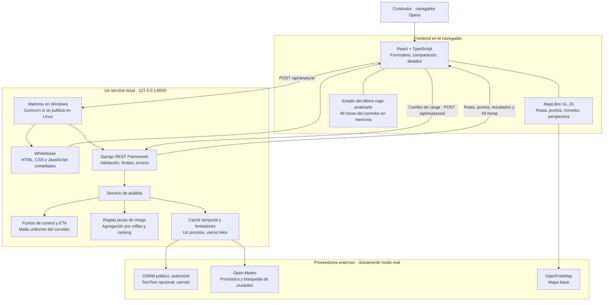

# Arquitectura y decisiones que Mauro debe poder defender

## Mapa del sistema

La API es nuestra puerta de entrada a la lógica de negocio. Las APIs externas son fuentes de datos. React no guarda claves de TomTom ni decide qué ruta gana. Vite prepara archivos del frontend; no corre como servidor de producción.

El mismo servicio local entrega el frontend y la API. En desarrollo se puede usar Vite en un segundo puerto; su proxy envía `/api` a Django. Los archivos de Render y Docker están preparados, pero **la publicación está pospuesta por instrucción del usuario**.

## Recorrido de una solicitud

1. El usuario elige ciudades de resultados de geocodificación, una salida con zona horaria explícita, carga y separación entre puntos.
2. DRF valida tipos, rangos, coordenadas finitas, zona IANA y ventana de salida. Los límites protegen el presupuesto gratuito.
3. El adaptador de rutas obtiene geometría y tiempo/distancia acumulados. OSRM usa anotaciones por arista. TomTom usa `progress`, interpolando según su contrato.
4. El módulo geométrico ubica puntos sobre la ruta cada 10, 25 o 50 millas, incluidos ambos extremos, y calcula ETA acumulada.
5. Se construye una malla del corredor independiente de los puntos de evaluación de rutas. Se deduplican coordenadas para consultar el clima.
6. Open-Meteo devuelve series horarias; sus unidades se validan. La caché reduce solicitudes repetidas. Los errores dejan datos desconocidos.
7. La lógica pura clasifica cada punto, aplica carga, agrega exposición por distancia y compara rutas elegibles.
8. La respuesta incluye resultados del viaje y las 49 horas del corredor. Mover el control temporal sólo actualiza fuentes del mapa en memoria.
9. El resultado se guarda en una caché separada y acotada, con un UUID aleatorio. Al cambiar carga, `/api/reassess/` recupera una copia y aplica nuevamente las reglas; no llama a proveedores. El original permanece inmutable para evitar que usuarios o solicitudes concurrentes modifiquen el pronóstico base.

La carretera coloreada y las millas por riesgo comparten la función `interval_risk`. La geometría de cada tramo conserva los vértices de la API entre los puntos de consulta. Así se evita una discrepancia entre lo que el mapa dibuja y lo que la recomendación calcula.

La interfaz separa sus responsabilidades en formulario, comparación, detalles del viaje, reglas y mapa. El mapa y su CSS se cargan de forma diferida; el contenedor tiene dimensiones explícitas para evitar que el estilo de MapLibre colapse el canvas. La interfaz usa solo inglés. El inicio no ejecuta consultas automáticas: el usuario compara su viaje con clima real o abre explícitamente el ejemplo. Un único grupo de tarjetas controla la selección del mapa; las opciones de muestreo, reglas y tabla se revelan bajo demanda. Los detalles de cada punto aparecen sobre el mapa. El corredor con capas y deslizador se muestra en la vista independiente de 48 horas.

El mapa ocupa `100dvh` y los paneles flotan encima. `useMapLayout` mide con `ResizeObserver` los paneles y el control temporal, reservando márgenes para la cámara sin reducir el canvas. En móvil se abre un solo panel inferior; cada panel tiene su propio desplazamiento. Seleccionar ambas ciudades encuadra sus coordenadas con una transición interrumpible antes de consultar rutas. Al editar una ciudad no se hace zoom hacia la otra mientras el campo está vacío. Una respuesta nueva encuadra la geometría real; cambiar carga u hora del corredor no reinicia el encuadre.

Durante un análisis nuevo se retiran del mapa las rutas anteriores y se muestran los extremos seleccionados, pulsos y tarjetas pendientes. No se dibuja un camino provisional ni se inventa un porcentaje de progreso. La respuesta sólo aparece al completarse; los errores conservan el análisis anterior si aún corresponde al viaje. `Best route` se refiere a la clasificación meteorológica del ejercicio, `Joint best` a un empate exacto y `Selected` a la ruta que el usuario inspecciona.

## Registro de decisiones

| Decisión | Por qué | Coste o límite aceptado |
|---|---|---|
| React + Django | Lo exige el ejercicio. React resuelve interacción; Django centraliza reglas y proveedores. | Dos ecosistemas de dependencias y una fase de compilación. |
| Un repositorio y un servicio | Facilita instalar, revisar y ejecutar. Un mismo origen evita configuración CORS innecesaria. | Frontend y API se publican juntos. |
| Reglas puras fuera de las vistas | Permite probar límites, carga, empates y datos ausentes sin red ni navegador. | Se necesita una capa pequeña de orquestación. |
| MapLibre + OpenFreeMap | Mapa con WebGL, capas y perspectiva; no requiere clave para el mapa base. | Depende de WebGL y de un servicio público sin SLA. |
| OSRM por defecto | Rutas reales sin clave: permite trabajar localmente inmediatamente. | Perfil de automóvil, sin restricciones legales o físicas de camión; visible en UI y README. |
| TomTom como adaptador opcional | Su v1 documenta camiones, salida y tiempos acumulados. | No se pudo comprobar contra una cuenta real sin clave; pruebas de contrato simuladas. |
| Alternativas y puntos de comparación | Si OSRM devuelve pocas alternativas, solicita rutas reales por puntos intermedios explícitos. | Pueden ser desvíos artificialmente largos. Se etiquetan y se comparan por clima; nunca se duplican rutas para fingir tres. |
| Open-Meteo | Series horarias, múltiples coordenadas y horizonte suficiente sin clave para prototipado. | Uso no comercial del servicio gratuito, cuotas y ausencia de SLA. |
| Mayor riesgo de los extremos | Aproximación conservadora, transparente y fácil de comprobar para cada intervalo. | No es una integral continua ni detecta todo evento entre puntos. |
| Promedio ponderado por distancia | Un tramo de 2 millas no pesa lo mismo que uno de 50. | Los números 0–4 asignados a categorías son una decisión de diseño, no una probabilidad de accidente. |
| Orden lexicográfico | Respeta las cuatro prioridades expresas. Ningún ahorro de tiempo compensa millas Severe mediante pesos arbitrarios. | Puede recomendar un desvío largo; es coherente con la prioridad pedida. |
| Sin base de datos | No se solicitan cuentas ni historial persistente. | Caché y resultados del navegador se pierden al reiniciar. |
| Un proceso con hilos | Caché y límites de proveedores son compartidos por las solicitudes de esta instancia. | Para varios procesos o réplicas hace falta Redis u otro coordinador compartido. |
| Dos referencias temporales | El viaje necesita clima a la llegada; el heatmap necesita una hora común espacial. | Hay que explicarlo en la UI y el video para evitar confundirlos. |
| Perspectiva en el mapa | Ofrece profundidad sin incorporar un motor 3D adicional. | No representa elevación real ni edificios 3D. |

## Calidad, privacidad y operación

- Claves sólo en `.env` ignorado o en el entorno del servidor. Los errores HTTP no imprimen URLs con credenciales. Los registros de `httpx` se reducen a advertencias.
- Validación del backend además de controles del frontend. Las coordenadas no se convierten en URLs arbitrarias del usuario.
- El servidor permite dos análisis simultáneos; las solicitudes de clima se agrupan y se espacian; OSRM se limita a menos de una solicitud por segundo.
- Límites explícitos: salida hasta cuatro días, conducción hasta 48 horas, máximo de 450 puntos de ruta por viaje. Un dato fuera del horizonte queda Unknown.
- La caché no es almacenamiento permanente. No hay cuentas, sesiones de usuario ni datos laborales ajenos al proyecto.
- Animaciones con respuesta inmediata, transiciones interrumpibles cuando aplica y respeto por movimiento/transparencia reducidos. Tablas y controles con teclado complementan el mapa.
- En despliegue: secreto obligatorio, `DEBUG=false`, hosts explícitos, HTTPS en Render y servidor WSGI apropiado. No se usa `runserver` como servidor de publicación.

## Pronóstico, salidas y navegación

El campo meteorológico se genera como una imagen geográfica en el navegador desde la malla recibida: interpola dentro de celdas conocidas y mantiene visibles riesgo bajo, datos desconocidos y límites de cobertura. Sus escalas son fijas; no usa la densidad de puntos como indicador de riesgo. Los márgenes de cámara reservan espacio adicional alrededor de A/B.

`departures.py` reutiliza las series meteorológicas originales para 25 salidas horarias por ruta. Estas series se guardan sólo en la caché privada; `public_analysis` elimina las claves internas antes de responder. `/api/departure/` valida un desplazamiento entero de 0–24, usa una copia del análisis y devuelve un UUID nuevo, conservando la instantánea anterior. La caché sigue acotada a 24 análisis y 15 minutos. No se agregan llamadas externas ni una base de datos.

Los enlaces de Google Maps se construyen con la API pública de URLs, con coordenadas y hasta tres puntos guía en orden. No transmiten el pronóstico ni la fecha de salida y no preservan de forma exacta la polilínea de OSRM/TomTom. El guardado persiste metadatos y puntos guía en `localStorage`, con diez registros como máximo, validación al leer y manejo de fallos de almacenamiento. Nunca se afirma guardar en una cuenta de Google.

## Qué no afirmar en una defensa

No afirmar que el riesgo es una predicción científica de accidentes, que OSRM garantiza acceso legal de un camión, que la capa difuminada tiene categorías exactas, que el modo demo muestra clima real, que el perfil opcional de TomTom fue probado con credenciales reales, ni que los tiempos incluyen descansos reglamentarios.

En la preparación de publicación se deja HSTS preload desactivado intencionalmente: es una aplicación nueva sin dominio definitivo y no se solicita una inclusión persistente en la lista de navegadores. `check --deploy` puede mostrar W021 por esa decisión. No implica una excepción al uso de HTTPS en Render.
