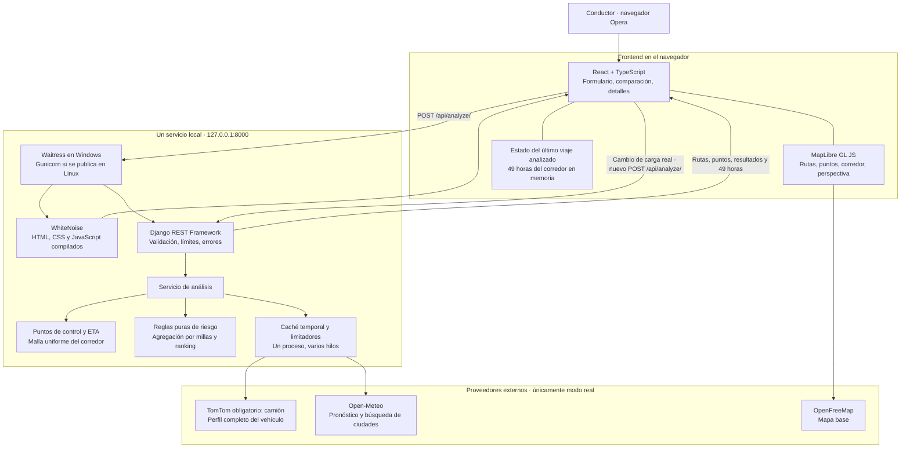

# Arquitectura y decisiones que Mauro debe poder defender

## Mapa del sistema

La API es nuestra puerta de entrada a la lógica de negocio. Las APIs externas son fuentes de datos. React no guarda claves de TomTom ni decide qué ruta gana. Vite prepara archivos del frontend; no corre como servidor de producción.

El mismo servicio entrega el frontend y la API. En desarrollo se puede usar Vite en un segundo puerto; su proxy envía `/api` a Django. Está publicado en un único servicio Render Free; detalles en `DEPLOYMENT.md`.

## Recorrido de una solicitud

1. El usuario elige ciudades de resultados de geocodificación, una salida con zona horaria explícita, carga y separación entre puntos.
2. DRF valida tipos, rangos, coordenadas finitas, zona IANA y ventana de salida. Los límites protegen el presupuesto gratuito.
3. TomTom recibe modo camión comercial, dimensiones cargadas, peso total, peso del eje más pesado y número de ejes. Devuelve geometría y tiempo/distancia acumulados mediante `progress`. Sin clave no se calculan rutas reales; no hay respaldo de automóvil.
4. El módulo geométrico ubica puntos sobre la ruta cada 10, 25 o 50 millas, incluidos ambos extremos, y calcula ETA acumulada.
5. Se construye una malla del corredor independiente de los puntos de evaluación de rutas. Se deduplican coordenadas para consultar el clima.
6. Open-Meteo devuelve series horarias; sus unidades se validan. La caché reduce solicitudes repetidas. Los errores dejan datos desconocidos.
7. La lógica pura clasifica cada punto, aplica carga, agrega exposición por distancia y compara rutas elegibles.
8. La respuesta incluye resultados del viaje y las 49 horas del corredor. Mover el control temporal sólo actualiza fuentes del mapa en memoria.
9. El resultado se guarda con UUID en caché acotada. Cambiar carga real invalida las carreteras. En perfil de ejemplo se actualiza la suposición por eje; en Custom se borra ese dato y debe indicarse otra vez. `/api/reassess/` rechaza cambios reales de carga con 409; solo el ejemplo meteorológico puede reevaluarse sobre carreteras fijas.

La carretera coloreada y las millas por riesgo comparten la función `interval_risk`. La geometría de cada tramo conserva los vértices de la API entre los puntos de consulta. Así se evita una discrepancia entre lo que el mapa dibuja y lo que la recomendación calcula.

La interfaz separa sus responsabilidades en formulario, comparación, detalles del viaje, reglas y mapa. El mapa y su CSS se cargan de forma diferida; el contenedor tiene dimensiones explícitas para evitar que el estilo de MapLibre colapse el canvas. La interfaz usa solo inglés. El inicio no ejecuta consultas automáticas: el usuario compara su viaje con clima real o abre explícitamente el ejemplo. Un único grupo de tarjetas controla la selección del mapa; las opciones de muestreo, reglas y tabla se revelan bajo demanda. Los detalles de cada punto aparecen sobre el mapa. El corredor con capas y deslizador se muestra en la vista independiente de 48 horas.

El mapa ocupa `100dvh` y los paneles flotan encima. `useMapLayout` mide con `ResizeObserver` los paneles y el control temporal, reservando márgenes para la cámara sin reducir el canvas. En móvil se abre un solo panel inferior; cada panel tiene su propio desplazamiento. Seleccionar ambas ciudades encuadra sus coordenadas con una transición interrumpible antes de consultar rutas. Al editar una ciudad no se hace zoom hacia la otra mientras el campo está vacío. Una respuesta nueva encuadra la geometría real; cambiar carga u hora del corredor no reinicia el encuadre.

Durante un análisis nuevo se retiran del mapa las rutas anteriores y se muestran los extremos seleccionados, pulsos y tarjetas pendientes. No se dibuja un camino provisional ni se inventa un porcentaje de progreso. La respuesta sólo aparece al completarse; los errores conservan el análisis anterior si aún corresponde al viaje. `Best route` se refiere a la clasificación meteorológica del ejercicio, `Joint best` a un empate exacto y `Selected` a la ruta que el usuario inspecciona.

## Registro de decisiones

| Decisión | Por qué | Coste o límite aceptado |
|---|---|---|
| React + Django | Lo exige el ejercicio. React resuelve interacción; Django centraliza reglas y proveedores. | Dos ecosistemas de dependencias y una fase de compilación. |
| Un repositorio y un servicio | Facilita instalar, revisar y ejecutar. Un mismo origen evita configuración CORS innecesaria. | Frontend y API se publican juntos. |
| Reglas puras fuera de las vistas | Permite probar límites, carga, empates y datos ausentes sin red ni navegador. | Se necesita una capa pequeña de orquestación. |
| MapLibre + OpenFreeMap | Mapa con WebGL, capas y perspectiva; no requiere clave para el mapa base. | Depende de WebGL y de un servicio público sin SLA. |
| TomTom obligatorio en modo real | Considera dimensiones, peso total y peso por eje del perfil usado. | Requiere clave; depende de cobertura. Solo carga no peligrosa. El ejemplo permite probar; debe ajustarse al vehículo real. |
| Perfil de ejemplo preseleccionado | Mantiene las cuatro entradas principales del ejercicio sin exigir seis campos nuevos. | Medidas y reparto por eje son suposiciones visibles, no datos de fabricante. Custom conserva validaciones y requiere peso por eje actualizado. |
| Marca opcional como etiqueta | Permite identificar el camión sin atribuir medidas a una marca completa. | No modifica restricciones ni consulta un catálogo de modelos inexistente. |
| Sin respaldo de automóvil | Un error o falta de clave no puede producir una ruta presentada como apta para camión. | Queda disponible el ejemplo meteorológico, identificado como no navegable. |
| Alternativas reales | Se solicitan hasta dos alternativas, además de la principal. | Si devuelve menos, se muestra la cantidad real; nunca se duplican rutas. |
| Open-Meteo | Series horarias, múltiples coordenadas y horizonte suficiente sin clave para prototipado. | Uso no comercial del servicio gratuito, cuotas y ausencia de SLA. |
| Mayor riesgo de los extremos | Aproximación conservadora, transparente y fácil de comprobar para cada intervalo. | No es una integral continua ni detecta todo evento entre puntos. |
| Promedio ponderado por distancia | Un tramo de 2 millas no pesa lo mismo que uno de 50. | Los números 0–4 asignados a categorías son una decisión de diseño, no una probabilidad de accidente. |
| Orden lexicográfico | Respeta las cuatro prioridades expresas. Ningún ahorro de tiempo compensa millas Severe mediante pesos arbitrarios. | Puede recomendar un desvío largo; es coherente con la prioridad pedida. |
| Sin base de datos | No se solicitan cuentas ni historial persistente. | Caché y resultados del navegador se pierden al reiniciar. |
| Un proceso con hilos | Caché y límites de proveedores son compartidos por las solicitudes de esta instancia. | Para varios procesos o réplicas hace falta Redis u otro coordinador compartido. |
| Dos referencias temporales | El viaje necesita clima a la llegada; el heatmap necesita una hora común espacial. | Hay que explicarlo en la UI y el video para evitar confundirlos. |
| Perspectiva en el mapa | Ofrece profundidad sin incorporar un motor 3D adicional. | No representa elevación real ni edificios 3D. |

## Calidad, privacidad y operación

- Claves sólo en `.env` ignorado o en el entorno del servidor. Los errores HTTP no imprimen URLs con credenciales. Los registros de `httpx` se reducen a advertencias.
- Validación del backend además de controles del frontend. Las coordenadas no se convierten en URLs arbitrarias del usuario.
- El servidor permite dos análisis simultáneos; las solicitudes de clima se agrupan y se espacian; OSRM se limita a menos de una solicitud por segundo.
- Límites explícitos: salida hasta cuatro días, conducción hasta 48 horas, máximo de 450 puntos de ruta por viaje. Un dato fuera del horizonte queda Unknown.
- La caché no es almacenamiento permanente. No hay cuentas, sesiones de usuario ni datos laborales ajenos al proyecto.
- Animaciones con respuesta inmediata, transiciones interrumpibles cuando aplica y respeto por movimiento/transparencia reducidos. Tablas y controles con teclado complementan el mapa.
- En despliegue: secreto obligatorio, `DEBUG=false`, hosts explícitos, HTTPS en Render y servidor WSGI apropiado. No se usa `runserver` como servidor de publicación.

## Pronóstico, salidas y navegación

El campo meteorológico se genera como una imagen geográfica en el navegador desde la malla recibida: interpola dentro de celdas conocidas y mantiene visibles riesgo bajo, datos desconocidos y límites de cobertura. Sus escalas son fijas; no usa la densidad de puntos como indicador de riesgo. Los márgenes de cámara reservan espacio adicional alrededor de A/B.

`departures.py` compara 25 salidas sobre la geometría y duración actuales usando pronósticos privados en caché. Esta comparación es meteorológica y no certifica acceso futuro. Aplicar una salida real mediante `/api/departure/` consulta nuevamente TomTom y el clima necesario: el acceso horario y el tráfico pueden cambiar. Solo el ejemplo aplica cambios sin proveedores. La caché permanece acotada a 24 análisis y 15 minutos; cada resultado recibe un UUID nuevo.

Google Maps solo se ofrece como vista previa de automóvil dentro de un desplegable: no recibe las restricciones del camión ni conserva su ruta. Se eliminó Start trip. Las rutas reales elegibles permiten exportar la geometría completa como GPX, con el perfil y una advertencia: el archivo no impone restricciones y requiere un navegador de camiones configurado con los mismos datos. El guardado local conserva perfil y geometría; las rutas antiguas de automóvil se identifican como legacy. Diez registros como máximo, validados al leer, sin cuenta Google.

## Qué no afirmar en una defensa

No afirmar que el riesgo predice accidentes, que todas las restricciones están cubiertas, que el GPX impone el perfil del camión, que el ejemplo es una ruta navegable o que los tiempos incluyen descansos reglamentarios. TomTom se comprobó con la clave Evaluation y un perfil de prueba; no equivale a certificar cada puente o permiso especial.

En la preparación de publicación se deja HSTS preload desactivado intencionalmente: es una aplicación nueva sin dominio definitivo y no se solicita una inclusión persistente en la lista de navegadores. `check --deploy` puede mostrar W021 por esa decisión. No implica una excepción al uso de HTTPS en Render.
